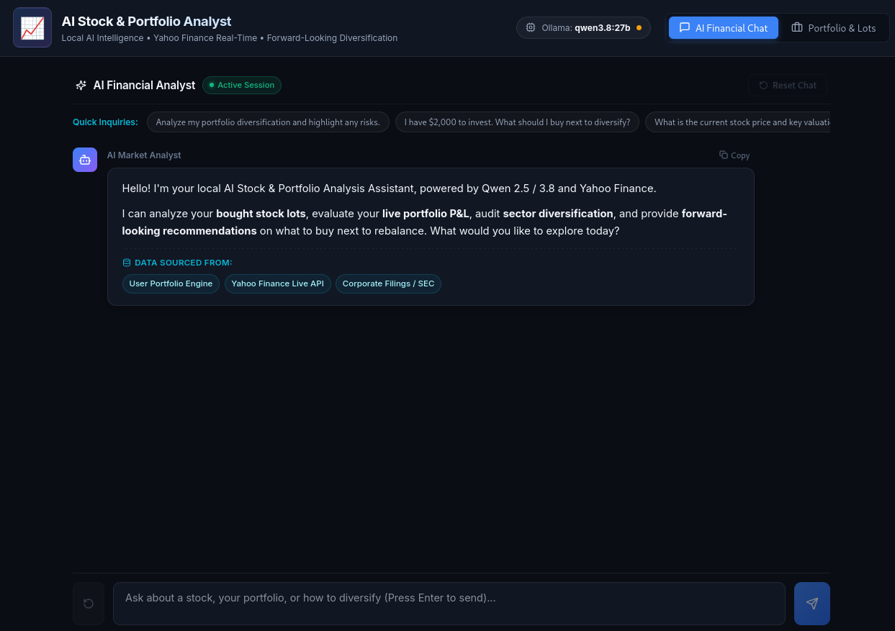

# AI Stock & Portfolio Analysis Assistant

A stock market analyst you talk to, built around your own brokerage portfolio. The core is a LangGraph ReAct agent with 11 tools: it reads real market data through `yfinance`, keeps a running account of every lot you bought, and audits the way your holdings are allocated against an S&P 500 sector benchmark. You ask it in plain English; it calls tools, works through the numbers, and streams the answer as Markdown.

The default setup runs entirely on your machine: a local Ollama model does the reasoning, your portfolio and lot history stay in a local JSON file, and the only network calls are the Yahoo Finance fetches for the tickers you ask about. A cloud OpenAI-compatible endpoint works just as well if you would rather not run a model.



---

## How It Works

```
                     ┌────────────────────────────────────────────────────────┐
                     │                   Client Browser                       │
                     │  ┌──────────────────────────────────────────────────┐  │
                     │  │        React + TypeScript (Vite on :3000)        │  │
                     │  │   - AI Financial Advisor Chat (SSE Streaming)    │  │
                     │  │   - Portfolio & Bought Lots Manager              │  │
                     │  │   - Sector Exposure Bars & Risk Indicators       │  │
                     │  └──────────────────────────────────────────────────┘  │
                     └───────────────────────────────────────────────────────┘
                                                 │
                                                 │ POST /api/chat (text/event-stream)
                                                 │ /api/portfolio/* (JSON)
                                                 │ (Vite dev proxy -> :8888)
                                                 ▼
                     ┌────────────────────────────────────────────────────────┐
                     │                    FastAPI (:8888)                     │
                     │  - LangGraph ReAct agent (InMemorySaver checkpointer)  │
                     │  - ChatOpenAI client -> your LLM endpoint (streaming)  │
                     │  - REST: /health, /api/config, /api/chat,             │
                     │    /api/portfolio, /api/portfolio/lots, /api/portfolio/upload,
                     │    /api/portfolio/reset, /api/portfolio/clear          │
                     └───────────────────────────────────────────────────────┘
                                                 │
                                                 ▼
                     ┌────────────────────────────────────────────────────────┐
                     │                     Tools (11)                        │
                     │  Market:      get_stock_price, get_historical_stock_  │
                     │                price, get_balance_sheet, get_key_     │
                     │                ratios, get_stock_news, get_analyst_   │
                     │                recommendations, get_company_profile   │
                     │  Portfolio:   get_portfolio_summary,                 │
                     │                analyze_portfolio_diversification,     │
                     │                recommend_next_buys, add_bought_lot   │
                     └───────────────────────────────────────────────────────┘
                                                 │
                          ┌─────────────────────┼─────────────────────┐
                          ▼                     ▼                     ▼
                     LLM endpoint          portfolio.json         Yahoo Finance
                    (Ollama local,         (gitignored; lots,     (live prices,
                     or cloud OpenAI-      cost basis, live      fundamentals,
                     compatible)           valuation)            news)
```

The portfolio engine does the deterministic math so the model never has to:

* **Valuation** · every lot's cost basis, current live value, and unrealized P&L in dollars and percent, aggregated per ticker and across the portfolio.
* **Diversification audit** · sector weights are compared against built-in S&P 500 sector benchmarks (Technology 31.0%, Financial Services 13.0%, Healthcare 12.0%, and so on). A single holding over **35%** of the portfolio is flagged as a high-risk concentration, and the top three holdings over **60%** as a moderate one. Any sector more than **15 points** overweight, or more than **5 points** underweight (or missing entirely), comes back as a flagged gap.
* **Forward-looking recommendations** · screens high-quality candidates in the underweight sectors and proposes concrete next buys: ticker, estimated share count, and dollar allocation.

Market data responses are cached for 60 seconds so a chain of tool calls does not hammer the API.

---

## Prerequisites

* **Python 3.10+** (developed and pinned against 3.14)
* **Node.js 18+** with npm
* **A model**, one of:
  * **Ollama, local (default)** · install Ollama, pull a model, and point `backend/.env` at `http://localhost:11434/v1`.
  * **Cloud, OpenAI-compatible** · e.g. the Thesys C1 endpoint; the `.env.example` has both options ready to flip between.

---

## Quickstart

### 1. Backend (terminal 1)

```bash
./start_backend.sh
```

That creates `.venv`, installs the pinned `backend/requirements.txt`, copies `backend/.env.example` to `backend/.env` if needed, and starts FastAPI on `http://localhost:8888`. Check `http://localhost:8888/health`.

Manual equivalent:

```bash
python3 -m venv .venv && source .venv/bin/activate
pip install -r backend/requirements.txt
cp backend/.env.example backend/.env   # then set your LLM endpoint/key
python3 -m uvicorn backend.main:app --host 0.0.0.0 --port 8888 --reload
```

### 2. Frontend (terminal 2)

```bash
./start_frontend.sh
```

Opens on `http://localhost:3000`. The Vite dev server proxies `POST /api/*` to the backend.

The app ships with a **sample portfolio** (seven lots: NVDA, AAPL, MSFT, AMZN, JNJ, SPY) so you can try everything immediately. Upload your own CSV from the Portfolio tab, or reset back to the sample at any time.

---

## Portfolio CSV Format

```csv
ticker,shares,buy_price,buy_date,account_type,notes
NVDA,20,118.50,2024-06-12,Taxable,AI Growth Tranche 1
AAPL,25,182.20,2023-11-05,Roth IRA,Long term hold
SPY,15,510.00,2024-05-01,Taxable,S&P 500 core ETF
```

Multiple lots per ticker are summed into one position (share count and total cost). Column headers are case-insensitive and accept common aliases (`ticker`/`symbol`, `shares`/`qty`, `buy_price`/`cost`/`price`, ...). The reference file lives at `backend/data/sample_portfolio.csv`.

---

## Things to Ask

* "What's my current portfolio valuation and P&L?"
* "Analyze my portfolio diversification and highlight any risks."
* "I have $3,000 to deploy. What should I buy next to fix my sector gaps?"
* "What's NVDA's P/E, PEG, and analyst consensus?"
* "Compare AMD and NVDA on valuation and analyst targets."
* "I bought 12 shares of COST at $880 today. Add it to my portfolio."

---

## API Surface

| Endpoint | Purpose |
|---|---|
| `GET /health` | liveness probe |
| `GET /api/config` | active provider/model metadata |
| `POST /api/chat` | streaming chat (SSE) with the ReAct agent |
| `GET /api/portfolio` | positions, live valuation, sector breakdown, risk flags |
| `POST /api/portfolio/lot` | add a single bought lot |
| `POST /api/portfolio/upload` | import a portfolio CSV file |
| `POST /api/portfolio/reset` | replace the portfolio with the bundled sample |
| `POST /api/portfolio/clear` | wipe all lots |

---

## Project Layout

```
backend/
  main.py            FastAPI app, SSE streaming, REST endpoints
  agent.py           LangGraph ReAct agent assembly
  config.py          environment loading (.env)
  tools/             the 11 agent tools (market + portfolio)
  portfolio/         storage (lots, CSV parse/alias mapping) and
                     analytics (valuation, benchmark audit, candidates)
  data/
    portfolio.json   your lots (gitignored)
    sample_portfolio.csv
  requirements.txt   pinned to exact versions
frontend/
  src/components/    Chat, dashboard, Portfolio & Lots view
  vite.config.ts     dev server + API proxy
start_backend.sh
start_frontend.sh
```

---

## Baseline

Started from the single-ticker chatbot in NeuralNine's "Advanced AI Stock Analysis Assistant in Python" ([AE_6F8cuXsA](https://www.youtube.com/watch?v=AE_6F8cuXsA)), then extended into the portfolio engine, the benchmark audit, and the forward-looking rebalancing tool.

---

## License

MIT
